# AI云管家使用说明书

> 规划评审版｜非当前线上操作手册
> 面向甲方项目负责人、品质主管、现场人员和系统管理员。
> 本书说明拟建设的使用方式与验收口径，不表示页面、接口、自动化流程已经上线。静态原型仅供讨论布局；上线培训应以实际验收后的操作手册为准。

## 1. 先读这一页：这套系统怎样协作

AI云管家把日常巡检、维保登记、异常整改、承接查验与报告归档连起来：现场人员留下真实记录，主管审核事实，整改人员处理问题，授权人员签署最终文件。AI 帮助看照片和填建议，不代替人的责任，也不能把未检查自动写成合格。

### 1.1 按工作身份找入口

| 使用者 | 日常工作 | 常用终端 |
|---|---|---|
| 现场巡检员、维保经办人 | 领任务、到场检查、拍照填表、维保登记、修改被驳回的本人记录 | App |
| 整改人员 | 在授权范围抢单或接受派工，逐项整改、提交复查 | App |
| 项目主管、品质经理 | 审核巡检、确认维保、派工复查、跟进查验、审核报告 | App 与电脑 |
| 甲方负责人、交接签字人 | 核对报告或交接内容，在本人获授权的环节签署 | App 或电脑 |
| 系统管理员 | 配置组织、项目权限、点位设备、计划、审核流程、输出模板与签章 | 电脑为主 |

这些是工作分工，不是额外的系统角色。账号权限分平台超级管理员、租户管理员、项目管理员、一线人员四档，并受所属租户、授权项目和具体操作权限约束。同一人可能承担多项工作，但不能审核本人提交的高风险记录或复查本人参与整改的工单。

### 1.2 三个“完成”不要混用

| 页面提示 | 真正含义 | 还不能代表什么 |
|---|---|---|
| 现场已提交 | 当前任务应检点位的表单已成功提交；巡检员可以结束本轮现场工作 | 不代表审核通过或所有设备正常 |
| 审核完成 | 应检记录最终审核通过；无法检查另列覆盖数、有效检查数 | 不代表异常已经整改闭环 |
| 工单闭环 | 整改证据已提交，独立复查通过 | 不代替原巡检审核，也不阻挡下一轮巡检 |

审核中、驳回待补正都不能算作“审核通过”。报告生成完也不等于签章归档完。看板应分别标明统计周期、项目范围和指标口径；加载失败不能显示假零。

### 1.3 三分钟上手，不靠读说明书

- 巡检员只记一句：打开「我的任务」→ 到场拍照填表 → 能现场解决就现场处理，解决不了提交异常。AI 慢不背锅，断网先看本地已存/待上传。
- 主管只记一句：先处理高风险和同类合并，派单看负载不看群聊；自己不在就配代理。
- 项目负责人只记一句：看管辖项目的一页摘要和对比，常规签署授权给对应负责人，只有重大风险/交接才升级。
- 管理员只记一句：新项目先导入行业预置包，再导台账，再批量生成二维码/NFC，最后试点验收。

培训交付物应是三分钟视频 + 一页卡片；本说明书用于评审和查口径，不作为一线培训材料。

## 2. 登录、四个 Tab 与日常入口

### 2.1 首次使用

账号由管理员开通，不在公网自行注册。支持**免账号密码直接进入（免登）**：已绑定微信/平台门户的员工可授权免登进入，免登只省输入密码，不省授权——首次免登仍需核对姓名、所属组织和当前项目；发现项目不对、权限缺失，联系管理员，不要借用同事账号。按管理要求修改初始密码，并在手机系统中按需允许相机、定位、NFC 等权限。

“我的”可维护个人手写签名、修改密码、查看关于、切换账号和退出登录。保存签名只是在系统中留一份个人签名素材，绝不表示同意某份报告。每次签署仍须打开对应文件、核对内容并执行确认。

### 2.2 四个 Tab 固定分工

| Tab | 看什么、做什么 |
|---|---|
| AI助手 | 微信式对话页（无输入时左侧语音/文字切换、右侧加号；输入文字后左侧隐藏、右侧加号 + 发送按钮；语音状态"按住 说话"长按录音、松开发送）：可命令 AI 完成工作（生成材料、查数据、派单等）；系统增删查改封装为工具供 agent 调用，回答流式渲染，写操作给一条紧凑确认条，确认后才执行 |
| 主页 | 【LOGO】+ 权限范围标识（无项目切换，默认聚合权限内全部项目）、滚动通知条（点左侧进公告列表、点右侧进公告详情）、物业经理移动看板（报事报修/物业收费/设施设备三列两行，点击进详情，分项目概况/客户服务/财务经营/品质保障）、最近使用八格（我的任务/欠费查询/巡检督查/抢单池/任务调度/岗勤管理/巡检台账/编辑站）、智管/智控/智创中台入口组（只显示常用功能，每组右上角「更多 ›」进该板块全部内容，每个入口独立配色） |
| 卷宗库 | 最近查看 + 八大分类（红色物业/合同协议/台账计划/服务报告/政策法规/内部制度/管理规约/安全应急）；巡检五册、承接查验六册与分户台账、维保台账归入台账计划类与服务报告类；归档件只读，纠错走作废/重出 |
| 社区 | 生态接入枢纽与服务集市：物料资源（运维物资遴选、外包服务商筛选/比价/履约跟踪）、智慧产品（自研/第三方 SaaS/硬件即开即用）、便民集市（物业审核后推送的本地服务市场）、邻里交互（寻人寻物/旧物置换，审核后展示）；默认混合推荐流，点板块图标切专属内容 |
| 我的 | 个人信息与个人设置，不再复制一套管理中心 |

通知不占 Tab：以主页滚动通知条呈现，点进通知列表页。社区 Tab（业主端联动）先不做。全部功能并入主页分区卡：任务执行（跨域：我的任务/巡查打卡/附近点位/手动补巡）、工单整改、品质管理、管理中心、系统设置；有权限才显示。执行任务不挂到单一业务域下面，记录/计划/审核/确认才回到对应管理分区。

扫一扫位于一级页面导航栏左上角，没有中央加号，也不放到右上角。二级页面左上角保留返回。首页常用入口与分区卡进入的是同一流程，不是两套功能。**基层执行人员只用记住「我的任务」：巡检任务、派给我的整改工单、派给我的维保执行工单都在里面；自己抢的单不在这里，抢单去工单池。**

AI 写材料、数据问答、IoT 智控等只在对应阶段实施并验证可用后开放；不能把规划入口当成现有能力。AI 生成的文字材料不是正式签署报告。

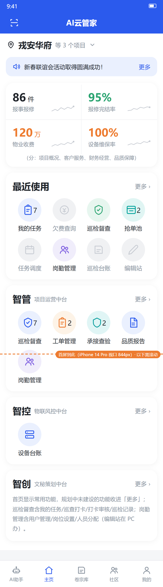
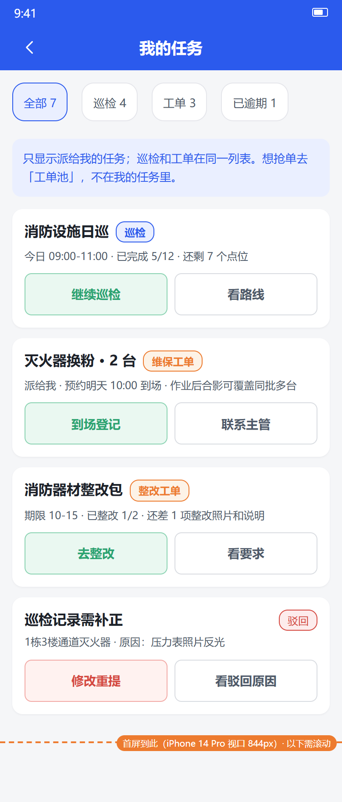

原型阅读提示：图中品牌、数字、默认值和旧入口仅是静态示意；出现与本书冲突的旧标注，以本书的目标流程为准，不作为已实现的证据。

## 3. 现场巡检员：从任务到本人记录

### 3.1 选任务与确认对象

从主页进入「我的任务」，巡检任务和派给我的工单在同一列表；按项目、楼栋、类型和状态缩小范围，再打开目标点位或工单。也可点左上扫一扫识别点位。先核对点位名、位置和设备身份，避免把相邻设备拍错。一个机房可有零台到多台设备，表单先列场所项，再按设备清单列逐台检查项。

任务中会显示现场已提交、待审、驳回待补正、审核通过等进度。提交后看成功回执或记录详情，不以按钮按过、照片传过就认定成功。巡检能现场解决的轻微问题，选择“异常已现场处理”并附前后证据；现场解决不了、需要别人/备件/资质/隔天的，才提交异常进入工单。

### 3.2 凭证与围栏是两项独立要求

管理员分别配置“如何证明到场”和“是否必须在围栏内”。凭证可为无需凭证、二维码、NFC，或在已配置的二维码/NFC 中任选一种；围栏另行启用。两项都启用时，两项都必须通过。扫到正确二维码并不自动代表位置合格；没有要求凭证，也不等于免围栏。

要求围栏的点位，定位失败、缺少点位坐标、半径配置不合法均不能默默跳过。先检查手机定位授权、到场位置和网络，再联系管理员修配置。手动补巡或“无法检查”不能绕过到场规则；确需例外，须有独立授权、原因与留痕。

### 3.3 在同一页完成检查

1. 完成所需到场确认后进入一页检查表，不再按“一张照片一个页面”的向导反复跳转。
2. 逐项读清名称与标准。正常/异常项按现场事实确认；数字带单位填写，日期、文本、选项按要求填写。默认选中不是已经检查的证明。
3. 必拍项上传对应现场照片，必填备注补全；有异常时选择实际观察点并说明情况。场所和设备不能串照片。
4. AI 开启的项拍照后自动识别，可继续填写其他项；AI 未开启则在相同表单中人工填写。
5. 提交前查看底部还差什么。所有必填项完整、当前 AI 请求无识别中状态，才可提交。

照片模糊、未拍到主体时按提示重拍。更换或删除照片后，以新照片对应的识别为准，旧识别结果不得覆盖新照片或人工结果。

### 3.4 AI 四种情况怎么处理

| 情况 | 巡检员怎么做 | 提交与审核要求 |
|---|---|---|
| 识别中（pending） | 继续填其他项，等待当前请求完成 | 任一项识别中均禁止提交；不能切换手动或使用无法检查绕过 |
| 识别完成 | 核对建议是否符合现场；不对可改判并填写原因 | 识别完成不是审核通过；保留 AI 原判与人工改判 |
| 识别失败、超时或额度不足 | 先重试；或在系统明确终结为失败后，逐项填写人工结论、必填值与故障说明 | 不自动填正常；故障记录必须人工强审 |
| 未启用 AI | 按标准人工检查、拍照和填值 | 仍须满足同样的必填与审核要求 |

异常、存疑、人工改判、AI 故障和无法检查，都必须由人工审核，不能配置成无人审核直接通过。若没有合格审核人，记录停留待处理并通知管理人，不让提交人自审。

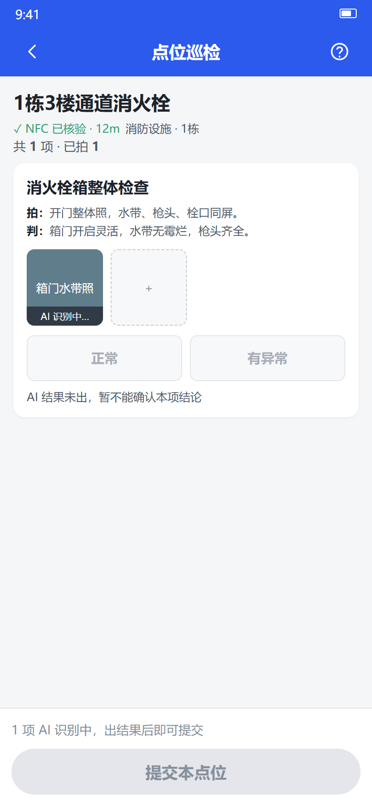
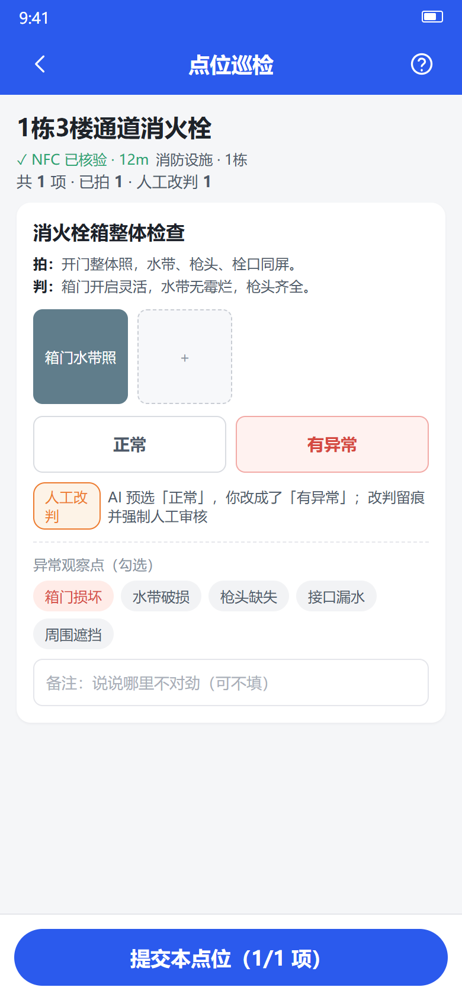

### 3.5 无法检查不是“正常”的快捷键

设备不存在、标签磨损、现场无法拍摄等，使用导航栏问号图标进入“无法检查”（避开小程序右上胶囊安全区）；仅个别标签不可读等情况可在对应项使用局部入口。注明影响哪些项、原因和要求的证据。整点位无法检查也要逐项留痕，不能把其他未检查项一键判正常。相机故障或不可拍摄能否免照片按明确配置执行；设备不存在、标签磨损一般需现场佐证。

无法检查单独统计，不当成正常项，也不直接算成已发现的故障项，必须人工审核。按钮位置以最终原型为准，不作为旧页面习惯沿用。

### 3.6 提交、草稿与驳回修改

中途离开前确认草稿保存状态；恢复网络后重新打开核对。草稿恢复以服务端确已保存为准，不承诺未上传的数据跨设备存在，也不把离线填写当成成功提交。

提交成功后到“巡检记录／我的巡检记录”查本人记录、照片、审核进度与原因。审核中不可直接改写已提交内容。被驳回后，原执行人或授权接替人在原记录上修改、重新核验并重提，保留旧修订与驳回日志；不要另建一条相同记录规避驳回。已归档锁定记录不得原地修改，纠错由管理人走作废、重审或重新出报告流程。

## 4. 维保经办人：从我的任务进入，不按设备重新找

### 4.1 维保任务与我的登记

基层没有独立“维保登记”表单入口。计划/到期或巡检异常生成的维保工单，派给我后出现在「我的任务」；到场执行后提交证据，进入待确认。设备台账里的“维保待办/维保确认”面向管理核对，不作为一线日常入口。“我的维保登记”查本人已提交、待确认、驳回、生效等登记。

厂家整批换粉、水压试验可共用整批现场照片，一张作业后合影可覆盖同批多台设备，不强求每台重复拍。批次凭证或新标签是否还要逐台拍，按动作类型和甲方要求配置；系统不把“合影”默认当成所有动作的充分证据。单台维修、更换新瓶按要求留该台证据。

### 4.2 一次登记不等于马上改台账

计划/到期维保按计划配置的提前量生成维保工单；已到期未安排的由每日扫描生成。聚合粒度与批量登记一致：同小区、同设备类型、同动作、同到期周期/施工批次生成一张工单，逐台设备是工单明细，不会几千台设备在池子里散成几千张卡。

纯维保工单执行提交后直接进维保生效确认，不再让主管先做工单复查、再做维保确认。确认人核对证据、动作类型和日期后一次确认：认可维保有效，即完成工单并回写台账日期。混合工单里只有非维保事项做工单复查；维修/清理类不推进有效期的动作，复查通过只记维修记录，不产生维保生效单。

待确认期间不能让台账日期提前变化。驳回后在“我的登记”查看原因并修改重提。确认通过才回写台账；流程无人确认时联系管理员配置，不能把空流程当成自动确认。

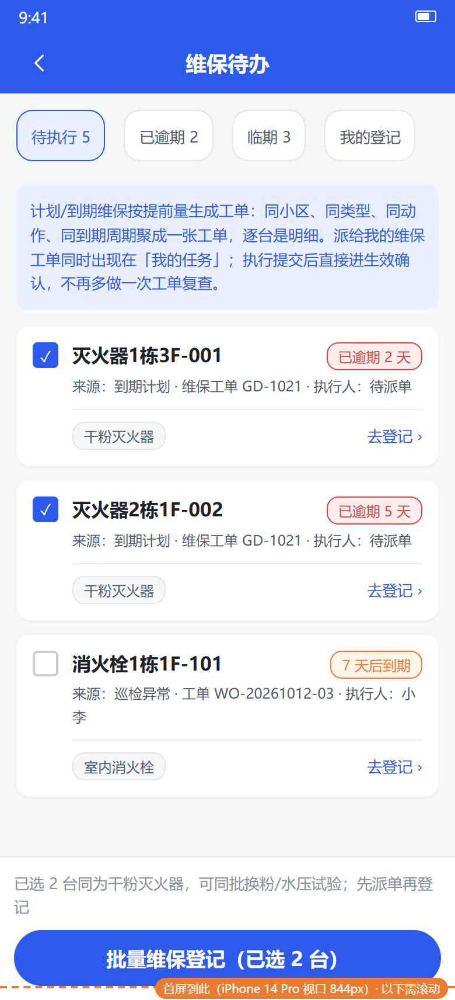
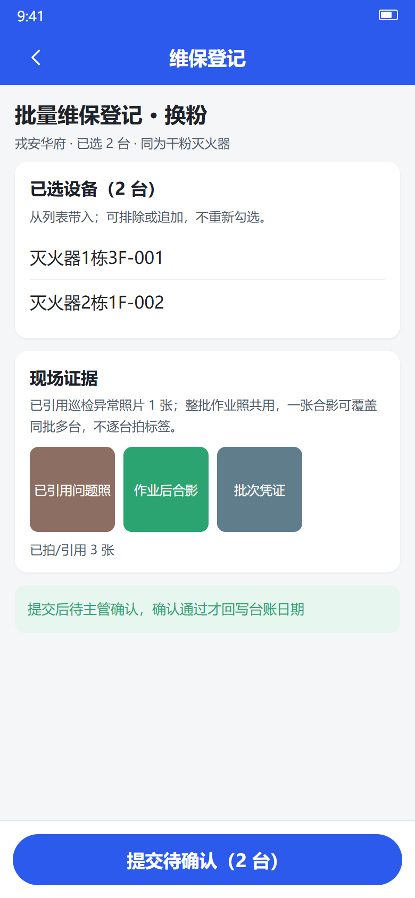

## 5. 所有角色共用：筛选、全选和部分失败

1. 先按类型、楼栋、状态等筛选，确认项目和业务范围。
2. “选择本页”只选当前页；“全选筛出的 N 项”选全部符合条件的结果，不是当前手机已加载的几十条。全选后可排除个别对象。
3. 核对已选数量、排除项和操作后果再提交。翻页可保留同一筛选下的选择，变更筛选应清空旧选择并提示，避免旧对象混入新范围。
4. 后台执行前会再查权限和对象当前状态。设备被别人处理、工单被抢走等应显示跳过或冲突，不覆盖他人的新结果。
5. 大批操作查看作业进度与结果：已处理、成功、失败、跳过分别计数。“处理完成”不等于“全部成功”。
6. 打开失败明细查看对象和原因，必要时导出。修正后只重试失败项，不把已经成功的设备重新登记；跳过项先核实原因，不能盲目再次执行。

超过单次上限时按界面提示拆批，不承诺任意规模一次处理。具体上限和处理耗时须按实施配置、实际数据与验收测试确定；本书不以静态图或未测数字作性能保证。

## 6. 项目主管与整改人员：审核后入池、整改后复查

### 6.1 巡检审核

主管从“待审核”进入记录详情，核对对象、现场证据、数值、AI 建议、人工改判与无法检查说明，按底栏“通过／驳回”处理。驳回必须说清缺什么、怎么补。高风险类别必须人工处理，不能混入“全正常记录”的批量通过。

正常记录的审核统一走**助手批量预审**（不再有按配置的自动系统审核）：对 AI 预选正常、证据齐、无异常、无人工改判、非本人提交的低风险记录，助手先预审并给出"建议通过"清单，主管确认一次即逐条审核通过，每条审核人仍记主管本人、留痕一致；AI 判异常、人工改判、无法检查、高风险项不在批量范围，仍须逐条人工审核。AI 直调只保留巡检/查验识别类能力（照片识别、读数、标签 OCR、资料扫描），不再单独承担审核结论。

巡检异常的顺序是：现场提交 → 人工审核通过 → 异常事项进入工单池。待审核或被驳回的异常不先派出去。审核通过与入池投递分别显示进度；入池延迟或失败由系统重试、管理人跟进，不要求巡检员重复提交。

### 6.2 工单池、抢单与派工

工单池只有一个入口；“可处理 / 整改中 / 待复查 / 已闭环”是筛选状态，不是四个业务页面。**工单池是抢单入口**：只显示当前人有资格抢的单，卡片给“抢单 / 看详情”；主管派单、改派、批量派单去“派单管理”。工单类型包括巡检整改、计划/到期维保执行、期3 报事报修等；承接查验问题不进工单池，维保生效确认单本身也不进工单池。授权人员可抢单，主管也可派给具有该项目执行资格的人。并发抢单只允许一人成功，失败者刷新查看最新状态。

改派须说明原因并保留原执行痕迹。只因为在人员名单里，不代表可以接所有项目或所有专业的单。无合格执行人时由主管配置或升级处理。

### 6.3 我的工单与复查

整改人员在“我的任务”打开工单，对每一项拍整改照片、写处理说明，全部完整后提交复查。复查人对照问题照片和整改证据逐项核对；通过才闭环，驳回则同一工单继续整改，保留前轮证据，不重新造一个问题。

纯维保工单不再单独走工单复查：执行人提交后直接进入维保生效确认，确认通过即完成工单并回写台账。混合工单中只有非维保事项需要工单复查，维保事项由维保确认替代，避免同一主管对同一证据点两次。

本人参与执行或提交的工单不能由本人复查；无人可复查时挂起并升级，不自动通过。“关闭无效／重复”须有权限和原因，不能统计成整改完成。工单未闭环不会阻挡巡检员完成下一轮巡检，但逾期应提醒并升级。

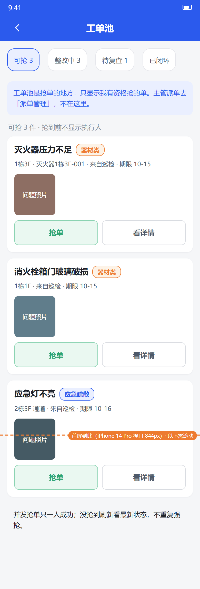
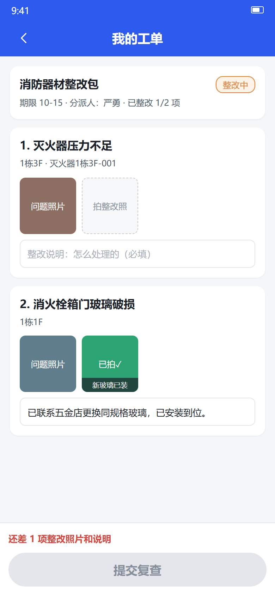

## 7. 承接查验参与人：批次、问题与交接

承接查验用于新项目接管，是独立业务，不复用日常巡检的任务频次、二维码到场或围栏规则。它是集中性交接，涉及资料、现场、物资、设施设备等；查验人员可不固定，由物业项目经理按批次统一分派。人员可以是项目内部员工，也可以是外聘临时人员；外聘人员使用批次级临时授权（与抢单即授权同机制：范围限该批次，结束自动回收），不占长期任职。分工分资料核查和现场查验；现场查验可按楼栋/单元划分，也可按园林绿化、康乐器材、供水供电设施设备等类型划分。该模块按立项与约定阶段实施，不因手册有图就视为已上线。

### 7.1 从批次进入，按对象选择三种录入

负责人建立项目、接管日期、查验组与范围明确的批次，再分派任务。项目经理/项目管理员只能为自己管辖的小区建批次；租户管理员可查看本租户全部小区并为任一小区建批次。查验人员可以是项目内部员工，也可以是外聘临时人员；外聘人员使用批次级临时授权。分工分资料核查和现场查验；现场查验可按楼栋/单元划分，也可按园林绿化、康乐器材、供水供电设施设备等类型划分。项目经理可手派，也可选随机分派，系统按成员、分工范围和对象数量自动分配，结果可预览调整。任务分工只在负责人配置页和「我的任务」范围里体现，普通查验详情页不展示全量分工。

普通查验路径只有：接任务 → 按分工逐项查内容 → 发现问题才拍照 → 选择问题类别 → AI 辅助识别问题点 → 人工确认 → 提交审核。**逐项看但不逐项拍照，只记录有问题的项**；正常项不拍照、不留逐条记录，查完按楼栋/册显式确认已覆盖，报告上已覆盖的无问题项默认为合格。类别由人工在拍照后选择，AI 不做专项识别。不把资料、钥匙、园林清单强行建成设备，也不在查验卡片上选择责任方。

| 录入方式 | 适用例子 | 现场怎么填 |
|---|---|---|
| 清单核对 | 资料、钥匙门卡、园林对象等 | 逐行核对名称、规格、数量和缺项，填已移交／缺项／待补，附文件或照片；扫描资料时 AI 先提取名称/编号/日期/页数/签章/数量，只生成待确认内容，人工核对后才提交 |
| 矩阵查验 | 房屋、公区、系统专项等 | 先选楼栋／楼层／区域等行对象，再逐项查看；**只登记有问题的项**：选“问题”才拍照、选类别、填事实，正常项不拍照不留逐条记录，查完按对象确认已覆盖 |
| 设备／统计录入 | 器材数量、状况、有效期等 | 按配置对象填数量、状况与日期，留对应证据；不套用日常巡检的同名表，也不回写设备台账 |

问题自动汇总到问题清单，保留来源、位置和证据。AI 识别只是建议，类别由人工在拍照后选择，人工确认后才算事实。查验问题只进入承接查验报告，不转工单池、不做整改跟踪；后续是否维修不由本模块闭环。

### 7.2 问题事实与签字主体分开

查验人员只记录问题事实：缺项、异常、位置、照片、说明；不需要选择责任方，也不需要填整改期限。按甲方口径，交接前发现的问题默认属于移交方/上一家需处理的事项；确有争议时，由项目负责人在报告与签署阶段处理，不在普通查验页长期展示。

“谁签字”是另一套签署配置。原件通用签章页为查验人、审核人，资料清单另有移交方、接收方；确需业委会或社区见证时，另行明确身份与授权，不预设固定三方签字。系统内部审核通过不代替外部主体签字。

普通查验人员不需要处理签署例外。带遗留交接由项目负责人在问题清单的“特殊处理”里集中完成：事实和证据完整、风险与安全措施明确，并由接收方明确接受，附在签署文件中。重大安全风险没有获批处置措施时阻断交接。不能用“已另立维修单”代替遗留接受；遗留项以接受文件和报告附件为准，本模块不做后续整改跟踪。

### 7.3 六类册名与编号核实

最新 05 已核对实际母版，下列是六个类别，并非已确认连续第 1～6 册。不得沿用旧摘要中“室外场地第5册”或臆定“物业用房第3册”。承接查验台账按甲方口径分三类：物业机构更迭承接查验（即上述六册）、新建物业承接查验（母版尚未提供，不臆造册号表型）、物业分户验收——另有独立的**物业分户查验台账**（户内专项，一户一档，按区/栋装订，封面册号留空未定），含分户验收记录表、栋级问题照片表、楼栋汇总表与水/电表底数明细。

| 类别名 | 已核实编号来源 |
|---|---|
| 物业资料 | 文件名标第1册，实际封面册号留空 |
| 房屋本体 | 封面第2册 |
| 设施设备 | 文件名及封面第4册 |
| 室外场地 | 封面册号空白，待甲方确认 |
| 物业用房 | 封面册号空白，待甲方确认 |
| 地下车库 | 文件名及封面第6册 |

未确认时评审输出使用类别名并明示册号未定；正式编号签署前须确认。批次报告核对目录、实际范围、问题清单与真实签署主体，审核后冻结事实、生成待签报告，签齐且满足遗留条件后归档；后续编辑不覆盖最终文件。

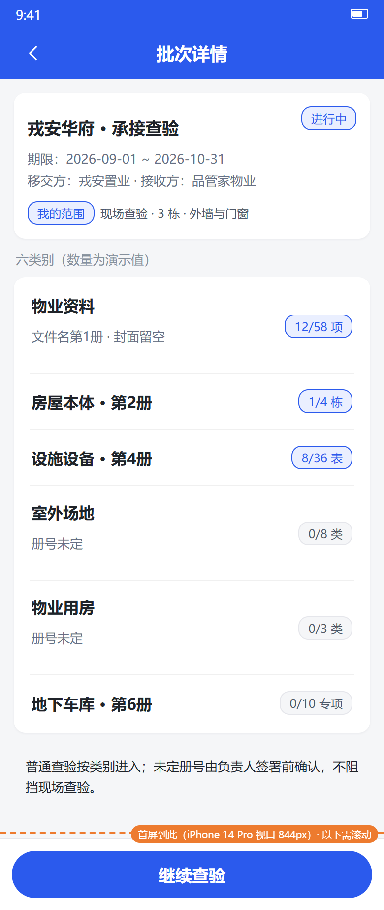
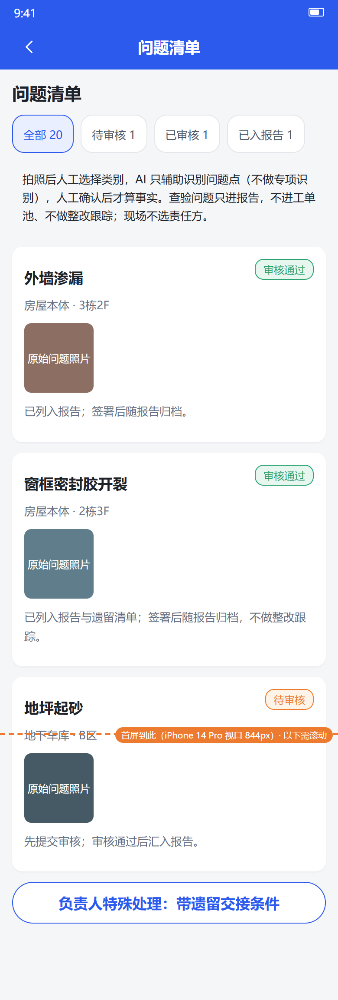

## 8. 负责人：五册报告、审核冻结与签章归档

### 8.1 生成与失败恢复

报告中心选择项目、期间与范围，生成巡检五册 PDF：供水设备（房）、供电设备（房）、消防设施（器材类）、消防设施（系统类）、特种设备（房）。五册是装订交付单位，不是只有五套检查项模板。

某系统当期无记录，也要保留该册的封面、零汇总、空明细骨架及“本月无巡检记录”说明，不能删册或造检查结果。生成进度按册展示：某册失败可针对该册重试；五册 PDF 全部就绪后，整份报告才能提交审核，不能缺一册先签。

设备很多的项目可选明细范围：全部明细、仅异常明细、正常代表样本 + 全部异常。选“正常代表样本 + 全部异常”时，每个点位/设备只展示本周期最早一条审核通过的正常记录作代表，异常记录全部展示；汇总表仍按全量已审核事实统计，报告封面和明细页眉会标明“正常项为代表样本”，不能当成只检查了这些设备。

转换服务未启用、字体缺失、生成超时、文件损坏都是待解决的阻塞。Word 下载可用于排查或核稿，但不是本期 PDF 交付成功的替代，也不能用“只交 Word”进入待签署／已归档。联系运维修复后重新生成并检查。

### 8.2 审核与签署的是同一份冻结内容

进入审核时冻结当次预览内容及对应文件，审核人先核对项目、期间、五册完整性、统计、异常与签字人。通过后授权人员对该内容执行签署、签章并形成归档件；不是审核后再悄悄按新模板重排。

个人签名素材、公章配置与每次签署授权是三件事。签署时须指向具体报告和冻结文件；没有权限不能代签。已签署内容如需修改，必须生成新报告并重新审核、重新签署，不能把旧签名贴到改过内容的新文件上。

报告列表每张卡只显示一个下一步动作：生成中看进度或重试失败册，待审核去审核，待我签去签字，已归档查看或下载；完整状态流转收进详情时间线。下载补印应取归档原件；截图、临时预览和自行编辑的 Word 不等同归档件。

### 8.3 重出不是覆盖，也没有模板历史版本恢复

改模板后重出，按最新配置生成新编号、新审核的新报告；旧归档文件原样保留。若仍在审批链中又要改内容，应按权限作废／重新生成，不能静默覆盖待审文件。

记录保留结果、实测值、照片、异常观察点、AI 与人工结论等事实，以及项名、标准文本、稳定项标识等最小展示快照；不保存整棵历史模板，也不建设模板版本恢复。查看当时完整排版与责任文件，以归档文件为准。新增项在旧记录中没有值就留空，不用当前标准重算并冒充当时结论。

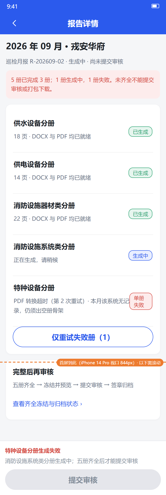
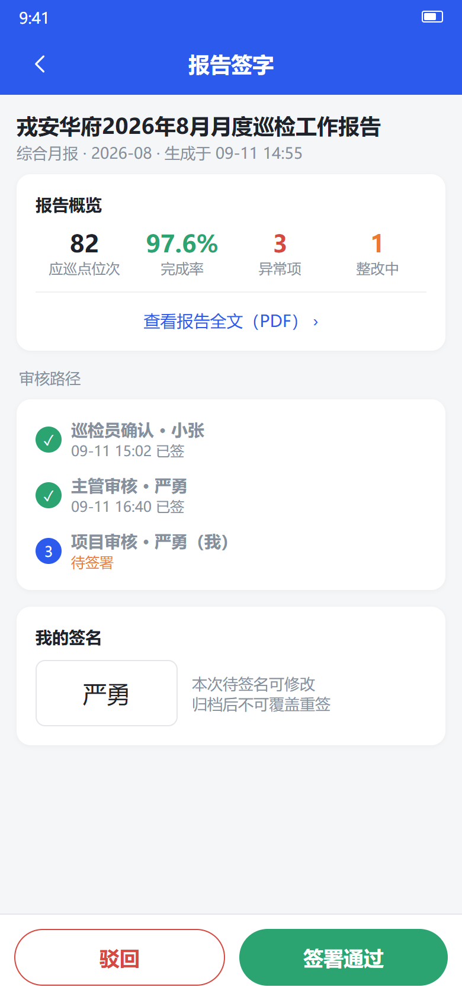

## 9. 管理员：配置怎么分，不要互相代替

### 9.1 三类配置各管一件事

| 配置 | 入口与用途 | 不负责什么 |
|---|---|---|
| 检查项模板 | 巡检管理 → 检查项模板；配置类型、用途、检查项、标准、值类型、阈值、必拍、备注要求及 AI 提示 | 不编辑列宽、合并表头、照片表、Word 母版 |
| 承接查验内容 | 品质管理 → 承接查验 → 查验内容配置；配置资料/钥匙/园林/固定资产清单，以及现场查验使用的 verify 检查标准 | 不放进设备台账列，不在 App 上编辑，不代替签署主体配置 |
| 台账字段方案 | 设备台账的类型配置；决定设备档案录入、列表、导入导出列 | 不代替检查项，也不管理非设备资料清单 |
| 输出模板 | 独立的系统设置／系统管理 → 输出模板；配置分册装订、表头分组、行列、照片区与版式 | 不改变现场检查事实，不放进检查项编辑器 |

检查项模板只回答“查什么、怎么查、合格标准是什么”。模板必须归属明确类型，草稿不能被计划选用，启用后才可选。同类型可以同时有多套标准和用途，例如控制室日常检查与系统功能检查；本期计划必须明确选择所需模板，任务保留选择结果，不能把同类型所有模板无条件拼成一张大表。

修改标准应在检查项中改，改版式去输出模板；两者都需授权与留痕。新排版形态是否支持要先验证，不承诺任意 Word 自动解析、像素级一致或未经测试的制作时效。改模板前可导出模板包人工留档，但这不是系统版本管理。

### 9.2 点位、设备与计划

点位是“去哪查”，配置类型、位置、凭证和独立围栏要求；设备是“查哪台东西”，管理编码、生产日期、维保规则、生命周期等。设备可挂在点位下；类型关联统一配置，不能维护两张互相冲突的映射。消火栓（栓箱）与灭火器按实际安装位置分别建点位、分别打卡拍照，不合并成一个点位一次打卡——两者不一定在同一位置，前期建点工作量大也应如实分开；**一设施一打卡**：每个消火栓/灭火器设施各自一张 NFC/二维码凭证，不共用；灭火器压力/日期等专项抽查按设备逐台拍照，本就独立。

设备台账按类型维护和导入导出。先下载对应类型的导入模板，核对列名、必填值和错误行，不要把不同设备类型的表混用。没有字段方案时应明确提示管理员补配置，不用“所有设备通用表”悄悄兜底。

巡检计划配置周期、执行人、对象范围、时段及模板选择；抽查计划按约定覆盖规则配置。修改计划不应改写已下发任务的选择快照。报告计划的周期不能代替巡检任务完成条件。

### 9.3 权限、流程和敏感资料

开通账号前核对组织、项目、角色和动作权限；离职、调岗、项目变更及时撤权。**角色就是岗位**：一个角色（项目经理、品质主管、工程主管、巡检员、维保工、楼管员、消控值班等）决定能用什么能力、能抢什么工单、看全项目还是只看本人；他在哪些小区工作由人员任职决定（选一个角色 + 勾选覆盖的小区）。巡检审核、维保确认、工单复查、报告签署与查验交接分别配置流程和合格候选人，避免只有提交人本人或空名单。

审批链的每个环节按职责命名（月报审批、打卡复核），**绑的是角色、不绑具体个人**；人员调岗/离职后由任职自动接续。环节绑的角色在该小区没有在职人员时，流程必须挂起并告警，不能跳过或自动通过。覆盖多个小区的报告，各小区的同角色人员都会进入候选（如两地项目经理各自签字）。休假、夜班、周末和调岗要配置生效时间与代理人，代理有范围、期限和审计，不能借账号。同一个人若持有多个账号（担任不同岗位时另建），系统按自然人去重，不允许用另一个账号审自己提交的记录。默认链可配 **agent 预审节点**：agent 用工具做复杂分析（对照识别结论、证据、数值、历史与同类问题分布），给出建议结论与依据供后续人工节点参考，不直接算审核通过；agent 不可用等同断链，挂起告警，不跳过。

签名、公章、手机号和查验资料按权限查看、导出。不得在群聊、截图或故障反馈中传播密码、密钥和无关个人信息。模板修改、权限变更、报告作废等高风险操作留审计记录；管理员不能因身份高就绕过本人复查隔离。

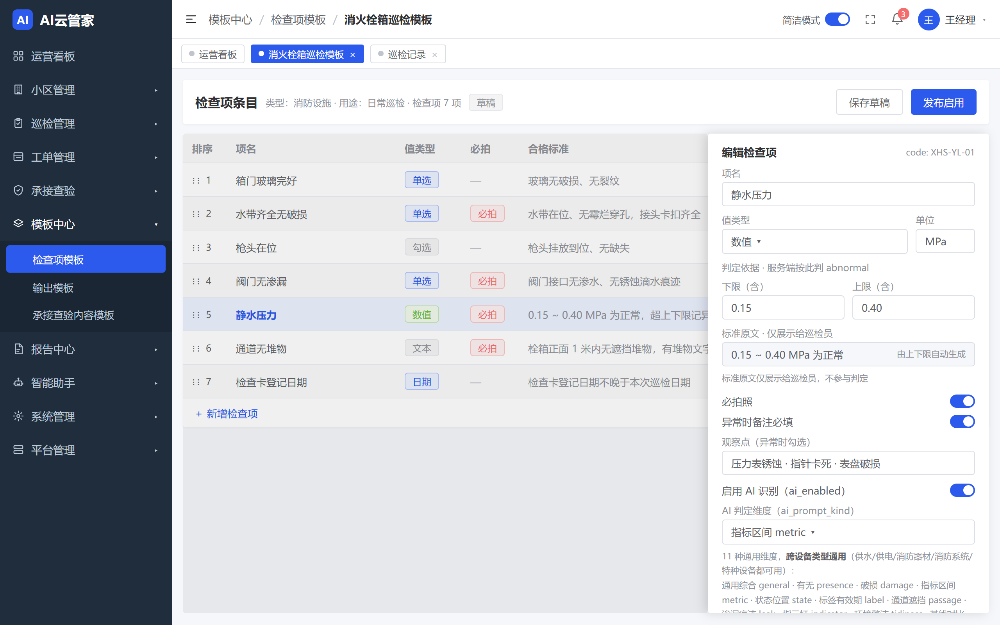
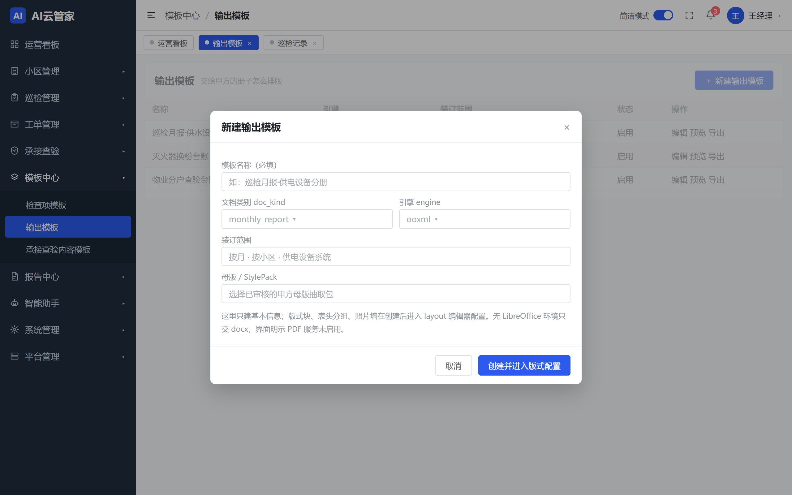

## 10. 通知、错误恢复与常见问题

### 10.1 消息不是业务结果的唯一凭据

通知显示对象、事件、时间与未读状态，点击直达具体记录、工单或报告。收不到通知先查业务列表与详情；通知失败会补发，不回滚已经成功的提交。消息中的对象已删除或当前无权查看，应解释原因并返回，不显示空白页。切换账号后重新核对项目，旧消息不授予新权限。

### 10.2 遇到错误按这个顺序处理

1. 先保留页面数据与草稿，记录业务编号、发生时间、当前状态和不含敏感内容的截图。
2. 网络断开或提交超时：不要立即重建记录，先恢复网络、查本人列表或作业回执，确认是否已成功。重复请求应返回原结果，冲突则刷新并核对新状态。
3. 上传失败：查文件格式、大小、网络和拍摄权限，重试失败文件；不能用他人项目照片顶替。
4. 定位或凭证失败：核对正确点位、授权、NFC 与配置，不通过就联系管理人，不伪造到场。
5. 审核／确认无人处理：联系管理员补合法流程，不把挂起当成通过。批量部分失败只处理失败项。
6. 报告生成或 PDF 转换失败：查看具体失败册和原因，由运维修复后重试；在全部 PDF 就绪前不报交付完成。

### 10.3 FAQ

| 问题 | 答复 |
|---|---|
| 提交按钮为什么灰了？ | 看按钮附近的具体提示：必拍、必填、到场要求或当前 AI 识别未完成。不能靠切换手动绕过识别中。 |
| AI 一直不回来怎么办？ | 联系管理人排查；由系统把超时落为明确失败，再重试或逐项人工填写并说明，走人工强审。不能把 pending 当故障放行。 |
| 我能改 AI 的结论吗？ | 可以按现场事实改判，填写原因并留原判；人工改判必须审核。 |
| 现场做完为何完成率没到 100%？ | 现场已提交与审核通过是两个指标；待审、驳回、无法检查的口径分别显示。 |
| 驳回后要重新扫码另建一条吗？ | 在本人原记录打开原因，修改并重提；如需重新到场核验按提示执行，不另造重复记录。 |
| 扫码成功为什么还拦我？ | 凭证与围栏独立，两者都要求时都要通过；也可能必填或 AI 尚未完成。 |
| 登记换粉后日期为什么没变？ | 提交只进入待确认；确认通过才正式生效。查看我的登记和确认链。 |
| 全选为何不是当前屏幕这些？ | “全选筛出的 N 项”包含同条件全部结果；本页选择另有范围提示。 |
| 批量显示完成但有失败？ | 作业结束不等于全部成功。看成功／失败／跳过明细，只重试失败项。 |
| 巡检异常为什么还没工单？ | 先看是否已人工审核通过，再看入池投递状态。失败由管理人重试，不重复提交巡检。 |
| 同事抢走我的候选工单怎么办？ | 刷新列表，只一人能成功认领；不要重复强抢或覆盖。 |
| 责任方没确定能交接吗？ | 查验时不选责任方、不填整改期限；交接前问题默认属移交方需处理事项。带遗留交接须事实、措施、接收方接受和必签齐全；重大风险未获批措施不能交接。 |
| 有 Word 没 PDF 可以算报告完成吗？ | 不可以。本期五册 PDF 全部就绪才能提交审核，缺转换服务属于阻塞。 |
| 为什么重出后与上次不同？ | 重出使用最新模板生成新报告；补印当时内容请下载旧归档原件。 |
| 报告签过了还能改字吗？ | 不改归档原件，走新报告、新审核、新签署；旧签名不沿用。 |
| 为什么看不到某个入口？ | 可能尚未实施或当前账号无权限。先核对项目与权限，不能据其他人的截图推定自己有权。 |

## 11. 评审时请共同核对

本书配图均引用工作区“原型图”目录实际存在的 PNG。配图用于辅助识别页面，不证明点击、接口、性能、字体或版式已经验收。关键失败态、本人记录和报告冻结等新增状态图已补充如下；完整 47 页以 [原型图索引](原型图/README.md) 为准，不用旧图推断状态规则。

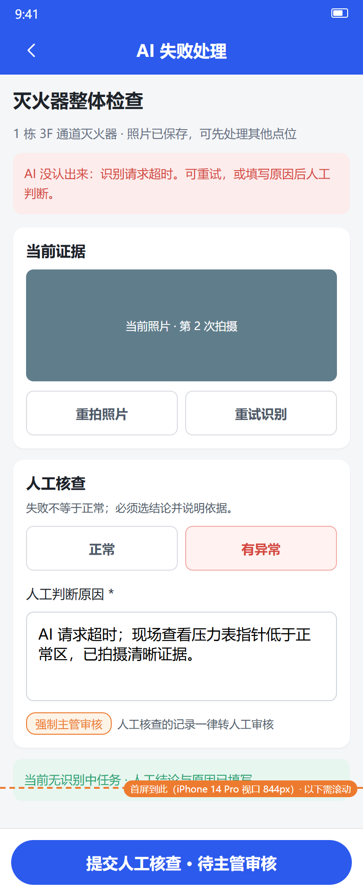
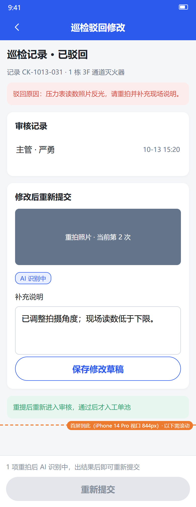
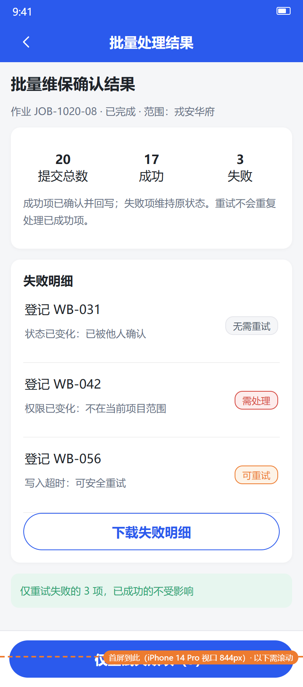
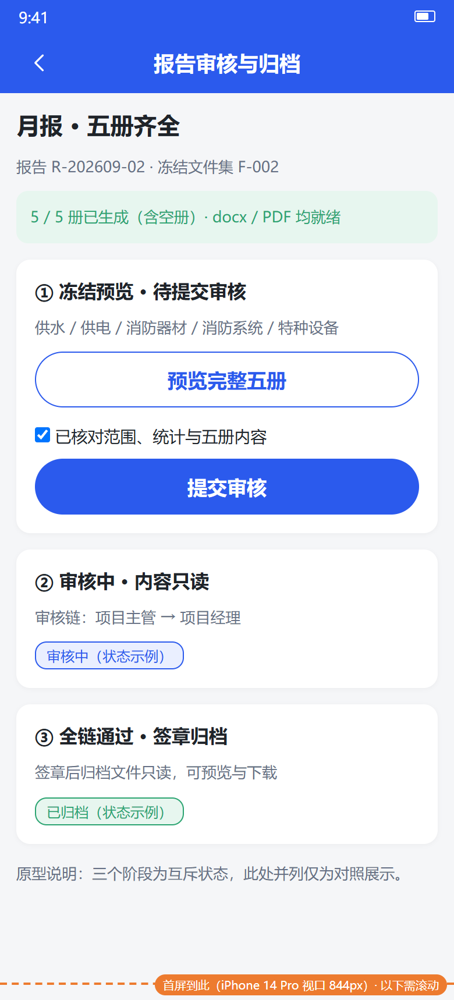
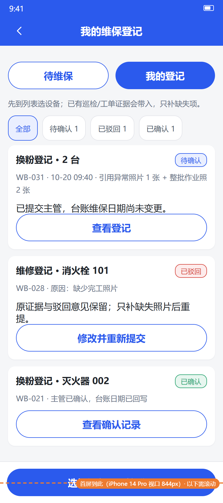
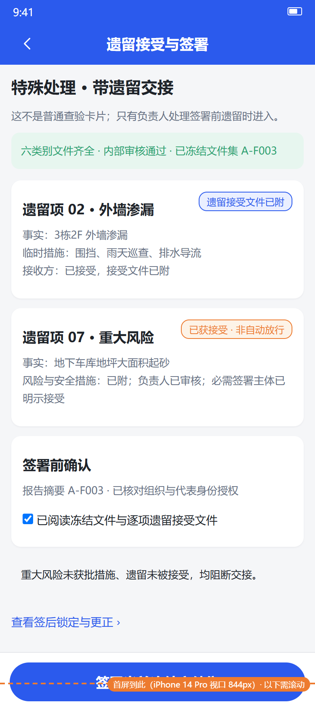
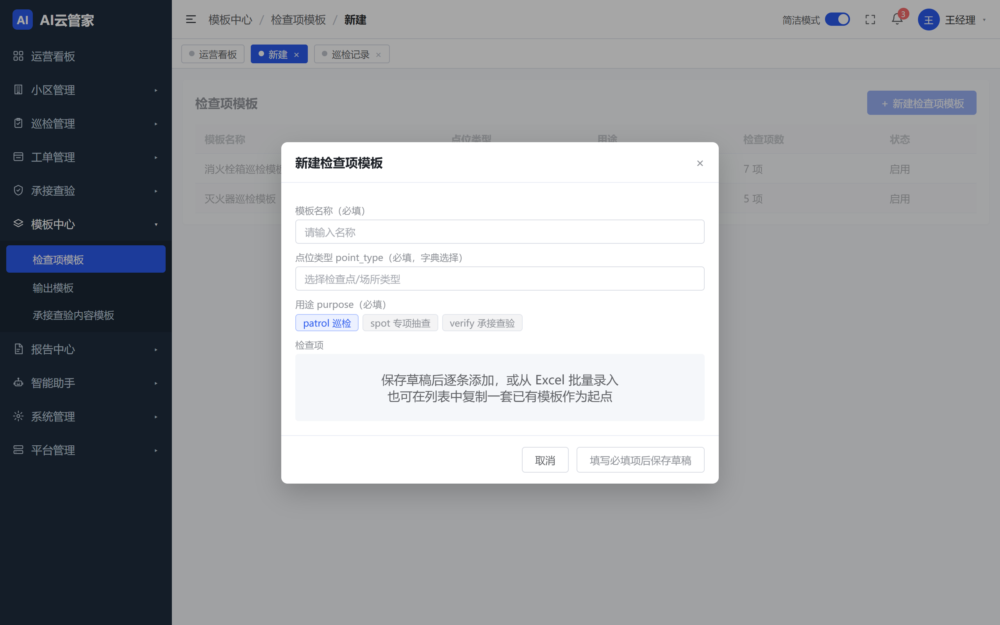

评审建议按一条真实业务串行演练：任务到场 → 人工／AI 填表 → AI 等待拦截与故障强审 → 驳回补正 → 审核通过入池 → 抢单／派工 → 整改复查；再演练整批维保部分失败、确认生效、承接遗留交接限制，以及五册生成失败恢复、冻结审核与签章归档。阶段开放范围、责任人和待确认项以双方确认的实施计划为准。

文档口径依据：02 App 框架、03 表单式巡检、04 工单、05 承接查验、07 批量作业、08 模板系统、09 扩展性设计。使用者无需理解内部技术字段；有冲突时先按评审确认的最新业务契约统一，再更新本书和上线培训材料。
